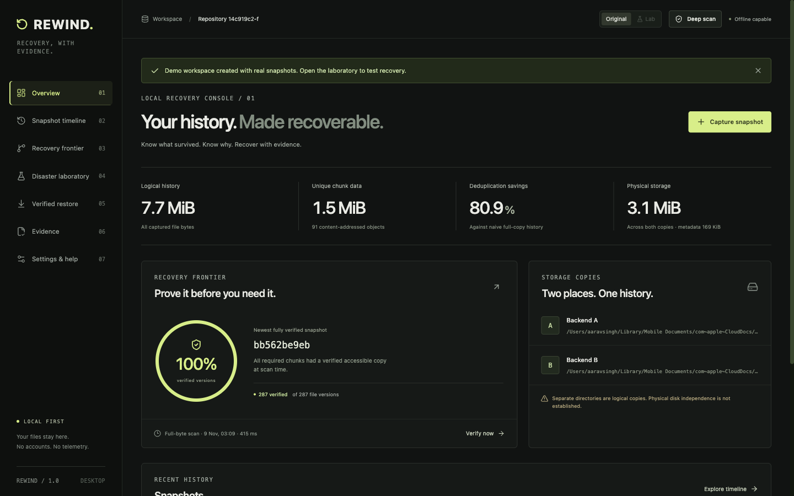

# REWIND

A local Electron desktop app for incremental backups, recovery analysis, isolated fault simulation and verified restoration.

REWIND connects physical chunk-copy evidence to historical file versions: see which bytes survived, why recovery is uncertain, and which snapshot can still be restored. Chunking, deduplication and snapshots use established techniques; this is a portfolio project with explicit failure-model limits.



## Run

Requires Node 22.13+, npm and a C compiler (macOS Command Line Tools or Linux `cc`). Tested on macOS arm64. Built-in `node:sqlite` prints an experimental API warning on Node 22.

```sh
npm ci
npm run dev
```

For production assets: `npm run build && npm start`. For an unsigned desktop bundle: `npm run package` (output under `release/`). Runtime operations are local; installation downloads dependencies.

## Try it

1. Click **Create demo workspace** to generate three real snapshots with edits, additions and deletion.
2. Inspect **Snapshot timeline**, then create a seeded copy in **Disaster laboratory**. Repeated automatic faults target intact copies; damaged bytes cannot be flipped back to health.
3. Open **Recovery frontier → Analyze recovery options**. A new deep scan finds the latest complete verified snapshot and newest individually verified versions per path. Mixed-version salvage is not one consistent historical snapshot.
4. Inspect a snapshot, then use **Verified restore** with a native-picked parent and a fresh child name. Restore rechecks chunks and whole files; **Verify output** independently checks the receipt.

Use your own data by selecting a source and two empty, separate storage directories. Capture reads the source without editing it. See [the walkthrough and CLI commands](docs/DEMO.md).

## Verify

```sh
npm run typecheck
npm run lint
npm run format:check
npm test
npm run test:integration
npm run build
npm run evaluate
```

`npm run test:ui` requires a graphical Electron session and the `agent-browser` CLI. `npm run package && npm run test:package` checks the packaged native publication helper with real restored files.

The [evaluation report](results/report.md) and [JSON](results/summary.json) record run dates, host conditions and timings. The harness compares 288 file-version classifications against an independent physical-byte oracle across 32 scenarios and restores a 10,023-file fixture. These are finite experiments with warm caches and two directories on one volume. See [acceptance coverage](docs/ACCEPTANCE.md) for executed checks and host limitations.

## Boundaries

Live capture is not an atomic application snapshot. Scan evidence is point-in-time; later reads can fail. Two directories on one disk do not protect against disk failure. Source symlinks and unsupported objects are reported; ACLs, xattrs, resource forks and ownership fidelity are not preserved.

Restore uses fresh staging, independently rereads output and publishes with exclusive native rename on macOS/Linux. Existing destinations are refused; destination ancestors must be privately controlled. Unsupported publication primitives fail closed. The macOS package is unsigned/unnotarized; Windows publication and external Linux CI execution are not validated here.

There is no encryption, GC, remote backend or repair execution. The separate budget-aware replica repair feature produces plans only. REWIND has no telemetry or cloud service; OS syncing of selected folders is independent of the app.

## Source and documentation

- `apps/desktop/`: Electron isolation and typed IPC, React interface.
- `packages/core/`: capture, storage, catalog, recovery, restore, fault lab and repair planning.
- `packages/cli/`, `packages/evaluation/`, `tests/`: CLI, independent oracle, benchmarks and actual SIGKILL tests.
- `native/`, `scripts/`: exclusive publication helper and reproducible build tools.

Read [architecture](docs/ARCHITECTURE.md), [durability limits](docs/DURABILITY_AND_LIMITS.md), [threat model](docs/THREAT_MODEL.md) and [UI constraints](docs/DESIGN_EVALUATION.md). Generated stores, dependencies and packages are ignored.
