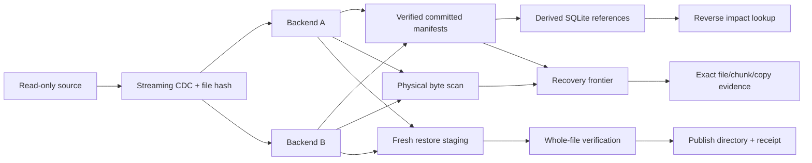

# Architecture and format v1

REWIND is a local Electron application and CLI using one TypeScript storage implementation. There is no server or outbound service. The renderer renders paginated evidence. A sandboxed preload exposes an allowlisted request method, folder picker, progress subscription, cancellation and opening a known receipt output. Main validates requests and owns native folder grants. One worker thread owns storage and short synchronous SQLite transactions, keeping storage work off the renderer/main event loops.

## Modules

- `packages/core/schema.ts`: strict versioned Zod formats, portable path validation, canonical JSON.
- `chunker.ts`: streaming gear content-defined boundaries, min 16 KiB, target approximately 64 KiB, max 256 KiB. A fixed generated 256-element gear table drives a 32-bit fingerprint; boundary mask `0xffff`, reset after a cut. This is a documented gear CDC variant, not a claim of exact FastCDC compatibility. Memory is bounded by read blocks plus a chunk; manifests scale with file/chunk count.
- `repository.ts`, `fs.ts`: safe init, traversal, immutable objects, publication, metadata discovery, diff and storage accounting.
- `catalog.ts`: rebuildable SQLite snapshots, versions and ordered references, indexed by chunk for reverse lookups; recorded scan evidence.
- `recovery.ts`: quick/full scans, conservative classification, snapshot aggregation, byte-range explanations, newest eligible versions and indexed impact propagation.
- `publication.ts` and `native/publish.c`: fixed-purpose executable for macOS/Linux atomic exclusive directory rename; no shell command construction or unsafe fallback. Source builds compile it; Electron packages it outside ASAR.
- `restore.ts`: staged reconstruction, alternate-copy fallback, file hashing, receipts, independent file reader and interrupted-restore reconciliation.
- `lab.ts`: physically copied sandboxes, opaque in-process mutation capabilities, persisted scenario records and replay.
- `repair.ts`: plan-only bounded exact solver and bundle-aware heuristic.
- `packages/evaluation/oracle.ts`: separately implemented physical-copy reader, whole-file assembler and classifier. Imports no production helpers.

## Data flow



## Durable layout

Each configured backend contains:

```
backend.json                  {version:1, repositoryId: UUID}
objects/ab/<64 hex SHA256>     immutable exact chunk bytes
manifests/<snapshot-id>.json   canonical UTF-8 JSON
commits/<snapshot-id>.json     {version:1, repositoryId, snapshotId}
```

The catalog home contains `repository.json` (version, id, source, two roots, creation time, demo flag), `catalog.sqlite`, `latest-scan.json`, `receipts/`, and `restore-intents/`. Storage directories and source/catalog must be pairwise non-overlapping and free of symlink components. Unknown schema versions fail closed. Backends can be opened without the catalog database; delete/rebuild it using the CLI or Settings.

A snapshot manifest has `{version:1, repositoryId, createdAt, session, label, sourceIdentity, parent, entries, skipped, limitations}`. UTC creation and random session are explicit identity inputs. Entries are strictly sorted canonical relative paths. Directory entries carry `type`, `path`, `mode`, `mtimeMs`; file entries add `size`, whole-file `hash`, ordered `chunks:[{hash,size}]`. Empty files have SHA-256 of empty bytes and zero chunks. Empty directories are entries. Parent directories must exist as directory entries. Duplicate and case-fold-alias paths, portable reserved names, traversal, non-NFC names and contradictory lengths are rejected.

Canonical JSON recursively sorts object keys, emits arrays in declared order and has no insignificant whitespace. SHA-256 of these bytes is the snapshot ID. Readers require canonical bytes and the expected ID from the commit filename/marker. This detects accidental damage; it is not an adversarial trust anchor. Parent/session/time differences intentionally change IDs.

## Publication and catalog

1. Acquire exclusive repository operation lock (OS advisory lock on a stable file descriptor; process exit releases it).
2. Traverse/read source, validate before/after metadata, stream chunks to both backends. Existing objects are hash-verified, never silently trusted or overwritten to hide corruption.
3. Re-read each unique referenced chunk on both backends and flush canonical manifests on both.
4. Publish atomic per-backend commit markers A then B. Each marker only refers to fully staged bytes on that backend. A crash between markers is degraded replication, not an incomplete committed snapshot.
5. Rebuild catalog in one SQLite transaction. A crash here can lose the index update while durable commits remain discoverable.

There is no distributed atomic transaction between stores. Uncommitted manifests/objects are not snapshots. Orphan objects are retained; no GC is implemented. Previously verified catalog manifests can describe known snapshots when commit metadata is inaccessible. This cache is explicitly marked degraded; losing the cache while both stores are offline loses that temporary visibility, not the stored history.

## Recovery evidence

Per-backend states: `VERIFIED_OK`, `CORRUPT`, `MISSING`, `BACKEND_UNAVAILABLE`, `NOT_YET_VERIFIED`, `IO_ERROR`. Each scan records ID, UTC time, full/quick scope, durations, copy evidence, counts and any contradictory whole-file metadata. Deep scan verifies object digests/lengths and, when complete chunks are accessible, verifies reconstructed whole-file digests with bounded memory. Quick scan only inspects paths. Scans are point-in-time evidence and can become stale; restore never relies on a cached green status.

| File-version conclusion | Evidence                                                                                                                                                                |
| ----------------------- | ----------------------------------------------------------------------------------------------------------------------------------------------------------------------- |
| VERIFIED_RECOVERABLE    | Every ordered required chunk has a verified accessible source; deep full-file consistency check passed when applicable. Empty files/directories require no chunk bytes. |
| PRESENT_BUT_UNVERIFIED  | No proved missing-on-all chunk, but accessible expected bytes remain unverified.                                                                                        |
| UNKNOWN                 | No verified source for required bytes, and inaccessible/erroring copies might contain them.                                                                             |
| KNOWN_UNRECOVERABLE     | At least one required chunk is missing or corrupt on every configured backend, with no remaining possible copy.                                                         |
| INVALID_METADATA        | No valid committed manifest, or deep verification proves a contradictory whole-file digest.                                                                             |

Snapshot aggregation exposes exact counts. A damaged snapshot may still contain individually salvageable file versions. `plan-recovery` selects the newest verified version per path and explicitly labels mixed-version plans as application-inconsistent and not a historical snapshot. Actual selective restores take explicit paths from a chosen snapshot. Explanations include exact digests, cumulative byte ranges `[start,end)`, copy states, shared-version fan-out and other historical versions. Frontier UI limits baseline rows to 50/page and history columns to the six newest snapshots; a selector reaches older history. Reverse chunk references support reclassification of only affected versions after a completed scan; physical scanning itself is full, not incrementally monitored.

## Restore transaction

Validate a fresh target and trusted existing parent, write a durable intent, create a sibling `.rewind-stage-UUID`, reconstruct ordered chunks with verified fallback, verify each whole-file hash/size, flush contents, restore supported metadata, independently re-read/hash the staged files, sync directories and atomically rename the stage into the absent target using the native exclusive-publication primitive. Then atomically write a `VERIFIED` receipt and remove intent. Failure retains intent/stage or already-published result without claiming success. `reconcile` independently reads a published destination and regenerates the receipt if bytes match. It does not overwrite a destination or treat partial staging as success.

Receipts identify version/repository/manifest/snapshot, exact selected paths, output path, file count/bytes, hashes, per-digest selected source backend, status, timestamps and limitations. Repeated uses of a digest share its source summary; this is an auditable summary, not a log of every read or cryptographic attestation.
